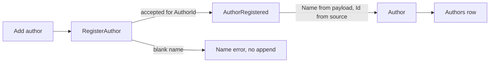

# Diagram the reviewable path

Read the arrows forward with the actor, then cover the left side and ask where each displayed field originated. Repair missing origins before treating the diagram as implementation input.
